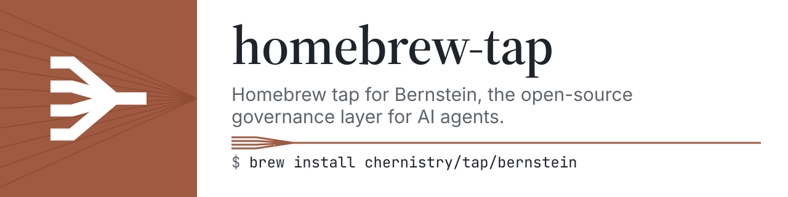

<picture>
  <source media="(prefers-color-scheme: dark)" srcset="https://raw.githubusercontent.com/chernistry/homebrew-tap/main/assets/brand/header-dark.svg">
  <source media="(prefers-color-scheme: light)" srcset="https://raw.githubusercontent.com/chernistry/homebrew-tap/main/assets/brand/header-light.svg">
  
</picture>

# homebrew-tap

Homebrew tap for [Bernstein](https://github.com/sipyourdrink-ltd/bernstein), the open-source governance layer for AI agents.

## Install

```sh
brew tap chernistry/tap
brew install bernstein
```

Or in one command:

```sh
brew install chernistry/tap/bernstein
```
